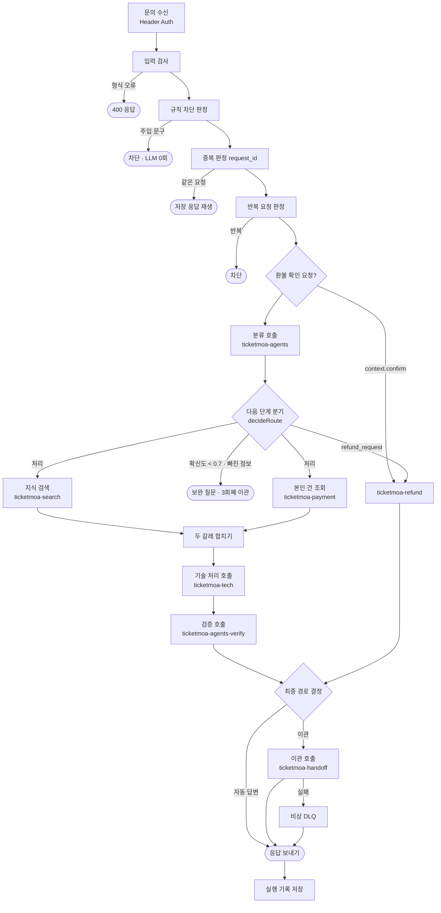

# 노코드 워크플로우 설계서 · 티켓모아

> 산출물 ① (35점 제안). 강의 자료 「기술지원자동화_전체아키텍처」 23쪽 목차 8절을 따른다.
> 담당: 1절 A 최두나 · **2~4절 B 최강현** · 5~7절 D 심환석 · 8절 함께.
> 노드 이름은 `workflows/*.json`의 실제 노드 이름이다. 본체(`ticketmoa-support`) 노드 이름은 `hwanseok-mvp` 브랜치 판 기준이며, A가 main에 병합할 때 이 문서와 맞춘다 (tflow로 비교).
> 상태: 2~4절 초안 (2026-11-04, B). 실제 n8n 실행 화면 예시는 서버 반영 뒤 채운다.

## 1. 업무 시나리오 · 처리할 문의 유형

(A 작성)

## 2. 전체 흐름 (단계 목록)

강의 자료 7쪽의 "문의 하나가 지나가는 8단계"에 맞췄다. 규칙으로 정할 수 있는 것은 규칙으로, AI는 뜻을 판단해야 할 때만 쓴다.

| 단계 | 하는 일 | 종류 | 워크플로우 · 노드 | 기준값 |
| --- | --- | --- | --- | --- |
| 1 받기 | 웹훅으로 질문 도착, 팀 키 확인 | 규칙 | support `문의 수신` (Header Auth `X-Team-Key`), `요청 시각 기록` | 응답 시간 예산 `deadline_ms` 시작 |
| 2 입력 검사 | 빈 질문 · 501자 이상 · 없는 사용자 → 400 | 규칙 | support `사용자 목록 조회` → `입력 검사` → `입력 판정` → `400 응답` | 500자, users 5명 |
| 3 문지기 | 주입 문구 차단, 같은 request_id 재생, 같은 질문 반복 차단 | 규칙 | support `규칙 차단 판정` → `규칙 통과?` → `중복 기록 조회` → `중복 판정` → `반복 요청 판정` → `반복 차단?` | 주입 패턴(lib/common.js), 요청 제한 |
| 4 분류 | 업무 유형 · 긴급도 · 감정 · 빠진 정보 | AI | support `레지스트리 로드` → `분류 호출` → **agents** `규칙 신호 추출` → `LLM 필요?` → `Supervisor 분류` → `분류 결과 검사` | 확신도 0.7, 긴급 = 공연 30분 이내 |
| 5 검색 | 지식 문서와 내 접수 건을 동시에 | 검색 | support `검색 필요?` → `지식 검색` ∥ `조회 필요?` → `본인 건 조회` → `두 갈래 합치기` → `결과 합치기` | top_k·점수 기준은 RAG 설계서 |
| 6 답변 | 찾은 근거로만 답 쓰기 | AI / 규칙 | 기술·앱·일반: tech (C). 환불: **refund** 규칙 문장 | 근거 없으면 이관 |
| 7 검증 | 근거 · 정책 · 개인정보 다시 확인 | AI | tech `검증 호출` → **agents-verify** `검증 프롬프트 조립` → `검증 Agent` → `검증 결과 검사` | 셋 다 true여야 통과 |
| 8 갈림길 · 기록 | 답 또는 이관, 실패하면 DLQ, 기록 남기기 | 규칙 | support `최종 경로 결정` → `티켓 필요?` → `이관 호출` → `이관 웹훅 정상?` → `비상 DLQ` → `응답 조립` → `응답 보내기` → `실행 기록 저장` | 기록에 질문 원문·연락처 없음 |

환불은 4단계에서 갈라져 `ticketmoa-refund`로 간다. 1차 요청은 금액만 안내하고(ticket null), 2차 요청(`context.confirm === true`)에서 같은 사용자·같은 예매·30분 안의 견적일 때만 환불 요청 티켓을 만든다. 실제 취소는 상담원이 한다.

## 3. 흐름도 · 워크플로우 파일 표

### 3.1 흐름도

강의 자료 8쪽처럼 윗줄은 걸러내기, 아랫줄은 답 만들기다. 걸러진 요청은 AI를 부르기 전에 끝난다.

구조도 원본: `images/orchestration.html` (인쇄용 `images/orchestration.pdf`). 청록 = AI, 흰 상자 = 규칙, 점선 칩 = 비상구, 빨간 테두리 = B 보안 장치.

### 3.2 워크플로우 파일 표

| 파일 | 웹훅 | 하는 일 | 담당 | 부르는 곳 · 시간 제한 |
| --- | --- | --- | --- | --- |
| `ticketmoa-support.json` | `/webhook/ticketmoa-support` | 본체: 1~3단계, 라우팅, 병렬, 8단계 | A | — |
| `ticketmoa-agents.json` | `/webhook/ticketmoa-agents` | 분류 (Supervisor) | B | support `분류 호출` 1~4초 |
| 〃 | `/webhook/ticketmoa-agents-verify` | 검증 Agent | B | tech `검증 호출` 0.5~2.5초 |
| `ticketmoa-refund.json` | `/webhook/ticketmoa-refund` | 환불 2단계 확인 | B | support `환불 호출` 1~5초 |
| `ticketmoa-index.json` | `/webhook/ticketmoa-index` | 색인 | C | 수동 |
| `ticketmoa-search.json` | `/webhook/ticketmoa-search` | 권한 필터 후 검색 | C | support 0.5~2초, refund 2초 |
| `ticketmoa-tech.json` | `/webhook/ticketmoa-tech` | 기술·앱·일반 답변, 대체 입장 | C | support 1~5초 |
| `ticketmoa-payment.json` | `/webhook/ticketmoa-payment` | 본인 건 조회, 남의 건 forbidden | D | support 3.5초, refund 4초 |
| `ticketmoa-handoff.json` | `/webhook/ticketmoa-handoff` | 요약 티켓 · 알림 · DLQ | D | support 1.5~5초, refund 5초 |
| `ticketmoa-errors.json` | Error Trigger | 오류 알림 | D | 모든 워크플로우의 Error Workflow |

시간 제한은 본체의 `deadline_ms`(요청 시각 + 예산)에서 남은 시간으로 계산하고, 위 범위로 자른다. 하위 웹훅은 실패해도 HTTP 200 + `{"error": ...}`로 돌려주고, 부르는 쪽은 오류 출력 갈래에서 이관으로 간다.

## 4. 역할 카드 · 분기 · 병렬 · 루프

### 4.1 역할 카드 (AI 직원 3명 + 문지기)

강의 자료 9쪽의 역할 나누기를 따른다. AI 결과는 JSON으로 받고 Code가 읽는다. 읽지 못하면 안전한 쪽(담당자 이관)으로 보낸다.

| 역할 | 노드 | 하는 일 | 결과물 | 하지 않는 일 | 못 읽으면 |
| --- | --- | --- | --- | --- | --- |
| 분류 triage | agents `Supervisor 분류` (gpt-4.1-mini, 반복 1회) | 업무 유형 · 긴급도 · 감정 · 빠진 정보 | `{intents[], entities{record_id, booking_id}, sentiment, urgency, confidence, clarity, missing[], clarify_question}` | 답하지 않기. 질문은 `<question>` 안 데이터로만 | `분류 결과 검사` → intents [] · confidence 0 → 이관 |
| 답변 writer | tech (C) | 검색한 근거로만 답 쓰기 | 답 + sources | 근거 밖 내용 · 약속 | 이관 |
| 검증 verifier | agents `검증 Agent` (gpt-4.1-mini, 반복 1회) | 근거 안의 답인지, 정책(환불 실행 주장 없음), 개인정보 | `{relevant, grounded, policy_ok, issues}` → `{ok, issues}` | 답을 새로 쓰지 않기 | `검증 불가 결과` ok false → 이관 |
| 문지기 guard | support `규칙 차단 판정` (규칙) | 공격 문구 판별 | `{blocked, blocked_by, reason}` | 답하지 않기 | — (규칙이라 항상 읽힘) |

문지기는 강의 자료에서 선택 항목이다. 우리 팀은 AI 대신 규칙으로 두어 LLM 호출 0회로 막는다 (WF-08). 환불의 금액·한도·확정은 어느 AI에게도 맡기지 않고 refund의 Code 노드가 정한다.

### 4.2 분기

| 분기 노드 | 조건 | 갈래 | 기준값 |
| --- | --- | --- | --- |
| support `다음 단계 분기` (decideRoute) | human_request · angry → 이관 / intents 없음 · 확신도 미달 · missing → 보완 질문 / attempt ≥ 3 → 이관 / 그 외 → 처리 | 4갈래 | 확신도 0.7, 최대 3회 |
| agents `LLM 필요?` | `!statusOnly && attempt < 3`이면 Supervisor, 아니면 `규칙 분류 결과` (상태만 묻는 문의 → booking_lookup, attempt ≥ 3 → intents [] · confidence 0 · `rule_attempt_limit`) | 2갈래 | 최대 3회, LLM 0회 |
| refund `단계 분기` | `pending_action = refund_request`이고 `context.confirm`이 boolean이면 confirm, 아니면 quote | 2갈래 | — |
| refund `조회 결과 분기` | ok / forbidden / not_found / error | 4갈래 | payment 4초 |
| refund `계산 결과 분기` | 견적 / 이관 | 2갈래 | 환불액 300,000원 초과 · 관람일 전날 17시 이후 → 이관 |
| refund `확인 단계 분기` | none / already / confirm / decline | 4갈래 | 견적 유효 30분, 사용자·예매 일치 |
| refund `재계산 분기` | 확정 / 금액 바뀜 / 남의 건 | 3갈래 | 재계산 금액 = 견적 금액 |
| support `최종 경로 결정` → `티켓 필요?` | 이관이면 handoff, 실패면 비상 DLQ | 2갈래 | — |

### 4.3 병렬

support `다음 단계 분기`의 처리 갈래는 `검색 필요?`와 `조회 필요?`로 동시에 간다. 필요 없는 쪽은 `검색 생략`·`조회 생략`으로 빈 결과를 넣어 `두 갈래 합치기`(Merge)가 항상 두 입력을 받게 한다. WF-12(공연 10분 전 QR + C-2002 확인)가 이 병렬로 대체 입장 근거와 접수 상태를 한 답에 담는다.

### 4.4 루프

n8n 안에서 되도는 루프는 만들지 않는다. 보완 질문은 요청 사이의 루프다. 고객이 다시 보낼 때 `attempt`가 1씩 늘고, 3회째에는 보완 질문 대신 이관한다 (WF-02, WF-02b). 3회째에는 분류 LLM도 부르지 않아 반복 요청이 비용을 쌓지 못한다 (agents `LLM 필요?`). 환불 2단계도 요청 두 번으로 나눈 루프이며, 상태는 `/cache`의 견적(`refund-pending:<user>:<booking_id>`, 30분)에 둔다.

### 4.5 보안 장치 (B 담당 부분)

자세한 위협 모델은 `security/refund-threat-model.md`, 객체·행동 정의는 `security/refund-ontology.json`.

- 확정은 `context.confirm === true` 하나로만. 질문 글이나 LLM 출력은 확정을 만들지 못한다.
- 견적에 `owner`·`expires_at`을 넣고, 확정 때 사용자·예매·만료를 다시 본다 (`확인 자격 판정`).
- context의 user·amount·role·approved는 쓰지 않고 `ignored_context`로 이름만 남긴다 (`요청 단계 판정`).
- 분류·검증 모델은 Credential `OpenAI (.env)`만 쓴다 (WF-10).
- 검증: promptfoo 환불 공격 세트 10/10, 공격 대응 세트 16/17 (계약 모형 기준, `security/promptfoo/`).

### 4.6 남은 일

- [x] `LLM 필요?`에 `attempt < 3` 조건 추가 (작업 지시서 B-2, 결함 F-003) · 2026-11-04, 노드 코드 실행으로 확인, n8n 실행은 서버 반영 뒤
- [ ] 서버 반영 뒤 n8n 실행 화면에서 분류·검증 입출력 예시 복사 (개인정보 가림)
- [ ] tflow로 흐름도와 실제 연결 비교
- [ ] 하위 웹훅 표(IMPLEMENTATION-PLAN)에 `ticketmoa-agents-verify` 행 추가 (A 승인)

## 5. 외부 연동 노드 (연습용 → 운영)

(D 작성)

## 6. 연결선마다 페이로드

(A · D 작성. 하위 웹훅 계약은 `docs/IMPLEMENTATION-PLAN.md` 1단계 표)

## 7. 오류 처리 (상황별)

(D 작성)

## 8. 64~79일차에서 가져온 것

(함께 작성)
