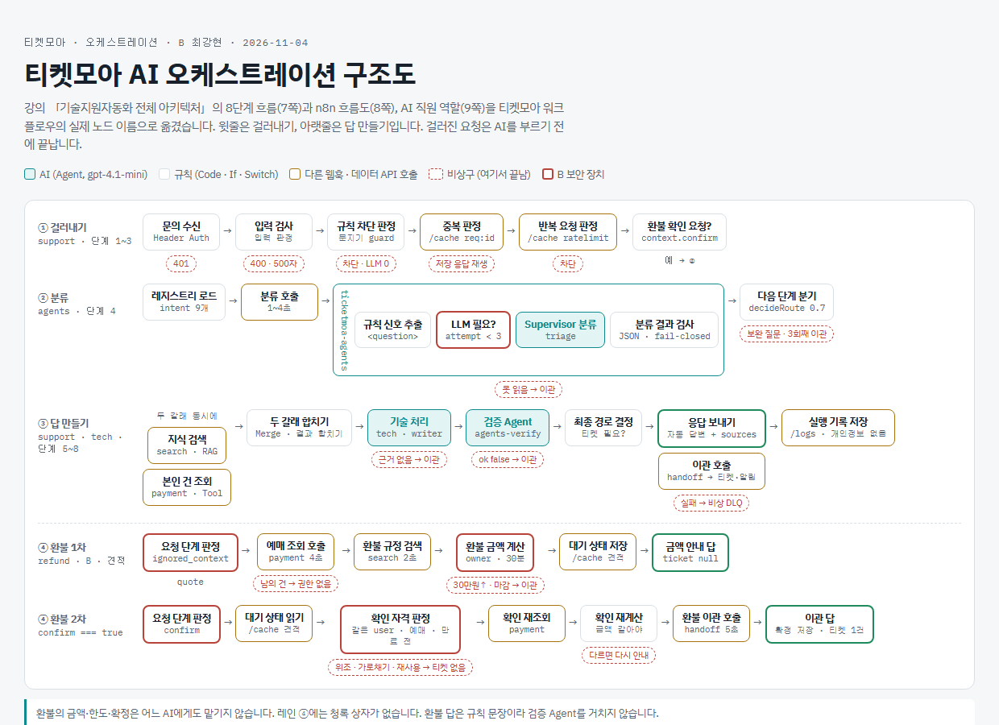
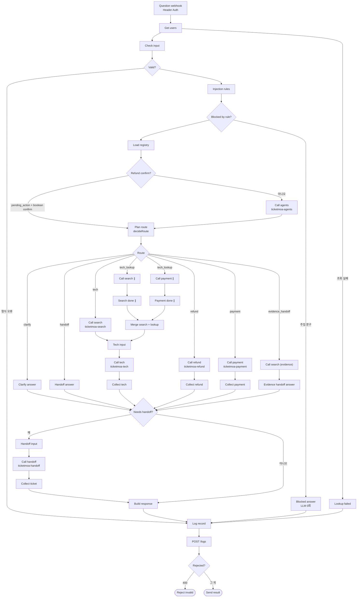

# 노코드 워크플로우 설계서 · 티켓모아

> 산출물 ① (35점 제안). 강의 자료 「기술지원자동화_전체아키텍처」 23쪽 목차 8절을 따른다.
> 담당: 1절 A 최두나 · **2~4절 B 최강현** · 5~7절 D 심환석 · 8절 함께.
> 노드 이름은 `workflows/*.json`의 실제 노드 이름이다. tech의 노드 이름은 파일이 올라온 뒤 맞춘다.
> 상태: 1절 초안 (2026-11-04, A) · 2~4절 초안 (2026-11-04, B, 본체 노드는 A가 실제 파일에 맞춤). 실제 n8n 실행 화면 예시는 서버 반영 뒤 채운다.

## 1. 업무 시나리오 · 처리할 문의 유형

### 1.1 업무 시나리오

가상의 온라인 티켓 예매 기업 티켓모아의 고객센터로 모바일티켓, 앱, 결제 오류, 입장 장애, 환불 문의가 들어온다. 이 워크플로우는 문의를 자동으로 분류하고 지식 문서와 예매 기록으로 답한다. 해결이 어렵거나 사람의 승인이 필요한 건은 요약해 상담원 티켓으로 넘긴다.

고객은 `POST /webhook/ticketmoa-support`로 질문을 보내고, 다음 다섯 가지 중 하나로 답을 받는다.

| route | 뜻 | 대표 시나리오 |
| --- | --- | --- |
| `자동 답변` | 문서나 본인 기록을 근거로 바로 답함 | WF-01 "모바일티켓 QR이 회색으로만 나오고 안 떠요" |
| `보완 질문` | 정보가 부족해 되물음 (3회째는 이관) | WF-02 "어제부터 계속 안 돼요" |
| `담당자 이관` | 요약 티켓을 만들어 상담원에게 넘김 | WF-03 지식 문서에 없는 문의, WF-12 공연 10분 전 입장 문제 |
| `권한 없음` | 본인 건이 아니어서 알려 주지 않음 | WF-06 남의 문의 번호 상태 조회 |
| `차단` | LLM을 부르기 전에 규칙으로 막음 | WF-08 프롬프트 주입 |

잘못된 입력(빈 질문, 없는 사용자, 501자 이상)은 route 없이 HTTP 400으로 거절한다 (WF-13).

### 1.2 처리할 문의 유형

업무 레지스트리(`Load registry`)의 9개 업무와, 어디에도 속하지 않는 문의를 다음과 같이 처리한다.

| 문의 유형 | intent_id | 예시 | 처리 | 근거 |
| --- | --- | --- | --- | --- |
| 모바일티켓·입장 장애 | `tech_issue` | QR이 안 떠요, 게이트 인식 실패 | 자동 답변. 공연 30분 이내 입장 문제는 긴급 이관 + 현장 알림 | `mobile-ticket-troubleshooting`, `onsite-entry-fallback` |
| 앱·계정 오류 | `account_issue` | 로그인 반복, 인증 문자 미수신 | 자동 답변 | `app-login-troubleshooting` |
| 공연장 이용 정보 | `general_info` | 주차, 입장 시간 | 자동 답변 | `venue-faq` |
| 예매·문의 조회 | `booking_lookup` | C-2002 어떻게 됐어요? | 본인 건만 자동 답변, 남의 건은 권한 없음 | 예매 기록 조회 |
| 결제 오류 | `payment_error` | 이중결제, 결제됐는데 예매 없음 | 조회 후 항상 이관 | `payment-error-guide` |
| 부정 예매 제한 | `fair_booking` | 매크로 의심 제한, 해외 접속 차단 | 사유는 자동 답변, 이의 신청은 이관 | `fair-booking-policy` |
| 암표 신고 | `scalping_report` | 웃돈 판매 신고 | 항상 이관 | `fair-booking-policy` |
| 환불 | `refund_request` | 취소하면 얼마 돌려받아요? | 1차 금액 안내 → 고객 확정 후 환불 요청 티켓 | `refund-policy` |
| 상담원 요청 | `human_request` | 상담원 연결해 주세요 | 항상 이관 | — |
| 등록 업무 아님 | (없음) | 제휴 카드 포인트 적립 | 검색 후 근거가 없으면 이관 | 검색 결과 |
| 의도 불분명 | (없음) | 어제부터 계속 안 돼요 | 보완 질문, 3회째 이관 | — |

### 1.3 자동으로 답하지 않는 경우

- 돈이 움직이는 처리: 에이전트는 환불이나 결제 취소를 실행하지 않고, 고객 확정 뒤 상담원 티켓으로만 넘긴다.
- 환불 예정액 30만원 초과, 관람일 전날 17시 이후, 공연 당일 취소 요청
- 강한 부정 감정, 고객이 상담원 연결을 직접 요청한 경우
- 지식 문서에 근거가 없는 질문
- 현장 스태프 전용 절차를 묻는 일반 고객 질문: `staff-entry-manual`은 `access_level`이 `staff`인 사용자만 검색한다.

### 1.4 데이터

| 데이터 | 개수 | 위치 |
| --- | --- | --- |
| 지식 문서 | 8개 (일반 7, 스태프 전용 1) | `knowledge/` |
| 사용자 | 5명 (일반 3, VIP 1, 현장 스태프 1) | `data/users.json` |
| 예매·상담 기록 | 6건 (C-2001~C-2006) | `data/records.json` |

모든 데이터는 가짜이며 연락처는 `010-0000-xxxx`, `@example.com` 형식이다. 외부 시스템은 연습용 데이터 API만 쓴다.

### 1.5 아직 구현하지 않은 범위

주제 제안서의 반복 요청 차단과 IP 차단(`rate_limit`, `geo`, `ip_blocklist`, TM-09~11)은 `lib/common.js`에 함수만 있고 `ticketmoa-support`에는 아직 연결하지 않았다.

## 2. 전체 흐름 (단계 목록)

강의 자료 7쪽의 "문의 하나가 지나가는 8단계"에 맞췄다. 규칙으로 정할 수 있는 것은 규칙으로, AI는 뜻을 판단해야 할 때만 쓴다.

| 단계 | 하는 일 | 종류 | 워크플로우 · 노드 | 기준값 |
| --- | --- | --- | --- | --- |
| 1 받기 | 웹훅으로 질문 도착, 팀 키 확인 | 규칙 | support `Question webhook` (Header Auth `X-Team-Key`) | — |
| 2 입력 검사 | 빈 질문 · 501자 이상 · 없는 사용자 → 400 | 규칙 | support `Get users` → `Check input` → `Valid?` (실패하면 `Log record` → `Rejected?` → `Reject invalid`). 사용자 조회 실패는 `Lookup failed` | 500자, users 5명 |
| 3 문지기 | 주입 문구 차단 | 규칙 | support `Injection rules` → `Blocked by rule?` → `Blocked answer` | 주입 패턴(lib/common.js) |
| 4 분류 | 업무 유형 · 긴급도 · 감정 · 빠진 정보 | AI | support `Load registry` → `Refund confirm?` → `Call agents` → **agents** `규칙 신호 추출` → `LLM 필요?` → `Supervisor 분류` → `분류 결과 검사` → support `Plan route` → `Route` | 확신도 0.7, 긴급 = 공연 30분 이내 |
| 5 검색 | 지식 문서를 찾고, 복합 문의는 내 접수 건도 함께 | 검색 | support `Call search` → `Tech input`. 복합 문의: `Call search ∥` → `Search done ∥`, `Call payment ∥` → `Payment done ∥` → `Merge search + lookup` → `Tech input` | top_k·점수 기준은 RAG 설계서 |
| 6 답변 | 찾은 근거로만 답 쓰기 | AI / 규칙 | 기술·앱·일반: support `Call tech` → tech (C) → `Collect tech`. 환불: `Call refund` → **refund** 규칙 문장 → `Collect refund`. 조회·결제: `Call payment` → `Collect payment` | 근거 없으면 이관 |
| 7 검증 | 근거 · 정책 · 개인정보 다시 확인 | AI | tech (C, 구현 예정) → **agents-verify** `검증 프롬프트 조립` → `검증 Agent` → `검증 결과 검사` | 셋 다 true여야 통과 |
| 8 갈림길 · 기록 | 답 또는 이관, 기록 남기기, 응답 | 규칙 | support `Needs handoff?` → `Handoff input` → `Call handoff` → `Collect ticket` → `Build response` → `Log record` → `POST /logs` → `Rejected?` → `Send result`. DLQ와 알림은 handoff가 처리 | 기록에 질문 원문·연락처 없음 |

환불은 4단계에서 갈라져 `ticketmoa-refund`로 간다. 1차 요청은 금액만 안내하고(ticket null), 2차 요청은 `Refund confirm?`이 `context.pending_action`과 boolean `context.confirm`을 확인해 분류 LLM 없이 바로 보낸다. 같은 사용자·같은 예매·30분 안의 견적이고 `confirm === true`일 때만 환불 요청 티켓을 만든다. 실제 취소는 상담원이 한다. 당일 취소 문의(`signals.show_day`)는 `Call search (evidence)` → `Evidence handoff answer`로 규정 근거를 찾아 이관한다. 강한 불만 문의도 같은 경로로 해당 업무 문서(레지스트리 `kb_scope`)를 찾아 이관한다.

## 3. 흐름도 · 워크플로우 파일 표

### 3.1 흐름도

강의 자료 8쪽처럼 윗줄은 걸러내기, 아랫줄은 답 만들기다. 걸러진 요청은 AI를 부르기 전에 끝난다.

구조도 원본: `images/orchestration.html` (인쇄용 `images/orchestration.pdf`). 청록 = AI, 흰 상자 = 규칙, 점선 칩 = 비상구, 빨간 테두리 = B 보안 장치.

> 구조도 이미지는 `hwanseok-mvp` 판 본체 기준이라 노드 이름과 일부 단계가 실제와 다르다. 실제 흐름은 아래 흐름도를 따른다.

tech 안의 검증(`ticketmoa-agents-verify` 호출)은 tech 파일이 올라온 뒤 이 그림에 더한다.

### 3.2 워크플로우 파일 표

| 파일 | 웹훅 | 하는 일 | 담당 | 부르는 곳 · 시간 제한 |
| --- | --- | --- | --- | --- |
| `ticketmoa-support.json` | `/webhook/ticketmoa-support` | 본체: 1~3단계, 라우팅, 병렬, 8단계 | A | — |
| `ticketmoa-agents.json` | `/webhook/ticketmoa-agents` | 분류 (Supervisor) | B | support `Call agents` 5초 |
| 〃 | `/webhook/ticketmoa-agents-verify` | 검증 Agent | B | tech (C, 구현 예정) |
| `ticketmoa-refund.json` | `/webhook/ticketmoa-refund` | 환불 2단계 확인 | B | support `Call refund` 5초 |
| `ticketmoa-index.json` | `/webhook/ticketmoa-index` | 색인 | C | 수동 |
| `ticketmoa-search.json` | `/webhook/ticketmoa-search` | 권한 필터 후 검색 (파일 대기) | C | support `Call search`·`Call search ∥` 5초, `Call search (evidence)` 2초, refund 2초 |
| `ticketmoa-tech.json` | `/webhook/ticketmoa-tech` | 기술·앱·일반 답변, 대체 입장 (파일 대기) | C | support `Call tech` 5초 |
| `ticketmoa-payment.json` | `/webhook/ticketmoa-payment` | 본인 건 조회, 남의 건 forbidden | D | support `Call payment`·`Call payment ∥` 2.5초, refund 4초 |
| `ticketmoa-handoff.json` | `/webhook/ticketmoa-handoff` | 요약 티켓 · 알림 · DLQ | D | support `Call handoff` 최대 5.5초에서 경과 시간을 뺀 값 (최소 0.5초), refund 5초 |
| `ticketmoa-errors.json` | Error Trigger | 오류 알림 | D | 모든 워크플로우의 Error Workflow |

support에서 `Call handoff`만 요청 시작부터 지난 시간을 빼서 시간 제한을 계산하고, 나머지 호출은 위 고정값을 쓴다. `deadline_ms`는 하위 웹훅에 넘기는 남은 시간(ms)이다. 하위 웹훅은 실패해도 HTTP 200 + `{"error": ...}`로 돌려주고, 부르는 쪽은 오류 출력 갈래에서 이관으로 간다.

## 4. 역할 카드 · 분기 · 병렬 · 루프

### 4.1 역할 카드 (AI 직원 3명 + 문지기)

강의 자료 9쪽의 역할 나누기를 따른다. AI 결과는 JSON으로 받고 Code가 읽는다. 읽지 못하면 안전한 쪽(담당자 이관)으로 보낸다.

| 역할 | 노드 | 하는 일 | 결과물 | 하지 않는 일 | 못 읽으면 |
| --- | --- | --- | --- | --- | --- |
| 분류 triage | agents `Supervisor 분류` (gpt-4.1-mini, 반복 1회) | 업무 유형 · 긴급도 · 감정 · 빠진 정보 | `{intents[], entities{record_id, booking_id}, sentiment, urgency, confidence, clarity, missing[], clarify_question}` | 답하지 않기. 질문은 `<question>` 안 데이터로만 | `분류 결과 검사` → intents [] · confidence 0 → 이관 |
| 답변 writer | tech (C) | 검색한 근거로만 답 쓰기 | 답 + sources | 근거 밖 내용 · 약속 | 이관 |
| 검증 verifier | agents `검증 Agent` (gpt-4.1-mini, 반복 1회) | 근거 안의 답인지, 정책(환불 실행 주장 없음), 개인정보 | `{relevant, grounded, policy_ok, issues}` → `{ok, issues}` | 답을 새로 쓰지 않기 | `검증 불가 결과` ok false → 이관 |
| 문지기 guard | support `Injection rules` (규칙) | 공격 문구 판별 | `{blocked, blocked_by, reason}` | 답하지 않기 | — (규칙이라 항상 읽힘) |

문지기는 강의 자료에서 선택 항목이다. 우리 팀은 AI 대신 규칙으로 두어 LLM 호출 0회로 막는다 (WF-08). 환불의 금액·한도·확정은 어느 AI에게도 맡기지 않고 refund의 Code 노드가 정한다.

### 4.2 분기

| 분기 노드 | 조건 | 갈래 | 기준값 |
| --- | --- | --- | --- |
| support `Refund confirm?` | `pending_action = refund_request`이고 `context.confirm`이 boolean이면 분류 없이 `Plan route`로, 아니면 `Call agents`로 | 2갈래 | — |
| support `Plan route` (decideRoute) → `Route` | human_request → 이관 / angry → 관련 문서가 있으면 evidence_handoff, 없으면 이관 / 뜻은 분명한데 등록 업무 없음 → tech / intents 없음 · 확신도 미달 · missing → 보완 질문 / attempt ≥ 3 → 이관 / 환불 + 당일 신호 → evidence_handoff / 그 외 → 업무별 처리 | clarify · handoff · tech · tech_lookup · refund · payment · evidence_handoff 7갈래 | 확신도 0.7, 최대 3회 |
| agents `LLM 필요?` | `!statusOnly && attempt < 3`이면 Supervisor, 아니면 `규칙 분류 결과` (상태만 묻는 문의 → booking_lookup, attempt ≥ 3 → intents [] · confidence 0 · `rule_attempt_limit`) | 2갈래 | 최대 3회, LLM 0회 |
| refund `단계 분기` | `pending_action = refund_request`이고 `context.confirm`이 boolean이면 confirm, 아니면 quote | 2갈래 | — |
| refund `조회 결과 분기` | ok / forbidden / not_found / error | 4갈래 | payment 4초 |
| refund `계산 결과 분기` | 견적 / 이관 | 2갈래 | 환불액 300,000원 초과 · 관람일 전날 17시 이후 → 이관 |
| refund `확인 단계 분기` | none / already / confirm / decline | 4갈래 | 견적 유효 30분, 사용자·예매 일치 |
| refund `재계산 분기` | 확정 / 금액 바뀜 / 남의 건 | 3갈래 | 재계산 금액 = 견적 금액 |
| support `Needs handoff?` | 이관이 필요하면 `Handoff input`으로, 아니면 `Build response`로. DLQ는 handoff가 처리 | 2갈래 | — |

### 4.3 병렬

support `Route`의 `tech_lookup` 갈래만 `Call search ∥`와 `Call payment ∥`로 동시에 간다. 두 결과는 `Search done ∥`, `Payment done ∥`를 거쳐 `Merge search + lookup`에서 합쳐져 `Tech input`으로 간다. 조회가 필요 없는 기술 문의는 `tech` 갈래에서 `Call search`만 부른다. WF-12(공연 10분 전 QR + C-2002 확인)가 이 병렬로 대체 입장 근거와 접수 상태를 한 답에 담는다.

### 4.4 루프

n8n 안에서 되도는 루프는 만들지 않는다. 보완 질문은 요청 사이의 루프다. 고객이 다시 보낼 때 `attempt`가 1씩 늘고, 3회째에는 보완 질문 대신 이관한다 (WF-02, WF-02b). 3회째에는 분류 LLM도 부르지 않아 반복 요청이 비용을 쌓지 못한다 (agents `LLM 필요?`). 환불 2단계도 요청 두 번으로 나눈 루프이며, 상태는 `/cache`의 견적(`refund-pending:<user>:<booking_id>`, 30분)에 둔다.

### 4.5 보안 장치 (B 담당 부분)

자세한 위협 모델은 `security/refund-threat-model.md`, 객체·행동 정의는 `security/refund-ontology.json`.

- 확정은 `context.confirm === true` 하나로만. 질문 글이나 LLM 출력은 확정을 만들지 못한다.
- 견적에 `owner`·`expires_at`을 넣고, 확정 때 사용자·예매·만료를 다시 본다 (`확인 자격 판정`).
- context의 user·amount·role·approved는 쓰지 않고 `ignored_context`로 이름만 남긴다 (`요청 단계 판정`).
- 분류·검증 모델은 Credential `OpenAI (.env)`만 쓴다 (WF-10).
- 검증: promptfoo 환불 공격 세트 10/10, 공격 대응 세트 16/17 (계약 모형 기준, `security/promptfoo/`).

### 4.6 남은 일

- [x] `LLM 필요?`에 `attempt < 3` 조건 추가 (작업 지시서 B-2, 결함 F-003) · 2026-11-04, 노드 코드 실행으로 확인, n8n 실행은 서버 반영 뒤
- [ ] 서버 반영 뒤 n8n 실행 화면에서 분류·검증 입출력 예시 복사 (개인정보 가림)
- [ ] tflow로 흐름도와 실제 연결 비교
- [x] 하위 웹훅 표(IMPLEMENTATION-PLAN)에 `ticketmoa-agents-verify` 행과 search `scope` 추가 (A 승인, 2026-11-04)
- [ ] 구조도 이미지(`images/orchestration.*`)를 실제 본체 흐름으로 다시 만들기
- [ ] tech 파일이 올라오면 노드 이름과 검증 호출을 이 문서에 맞추기

## 5. 외부 연동 노드 (연습용 → 운영)

(D 작성)

## 6. 연결선마다 페이로드

(A · D 작성. 하위 웹훅 계약은 `docs/IMPLEMENTATION-PLAN.md` 1단계 표)

## 7. 오류 처리 (상황별)

(D 작성)

## 8. 64~79일차에서 가져온 것

(함께 작성)
