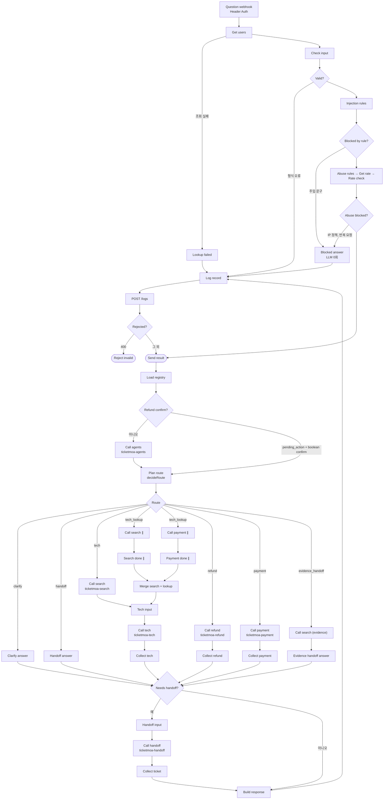

# 노코드 워크플로우 설계서 · 티켓모아

> 산출물 ① (35점 제안). 강의 자료 「기술지원자동화_전체아키텍처」 23쪽 목차 8절을 따른다.
> 담당: 1절 A 최두나 · **2~4절 B 최강현** · 5~7절 D 심환석 · 8절 함께.
> 노드 이름은 `workflows/*.json`의 실제 노드 이름이다.
> 상태: 1절 초안 (2026-11-04, A) · 2~4절 초안 (2026-11-04, B, 본체와 tech 노드는 A가 실제 파일에 맞춤). 5~8절 초안 (2026-11-04, A 작성, D 확인 필요). 실행 예시(4.6절)의 표는 로컬 n8n 결과이고, 팀 VM 결과는 4.6절 끝에 따로 적었다.

## 1. 업무 시나리오 · 처리할 문의 유형

### 1.1 업무 시나리오

가상의 온라인 티켓 예매 기업 티켓모아의 고객센터로 모바일티켓, 앱, 결제 오류, 입장 장애, 환불 문의가 들어온다. 이 워크플로우는 문의를 자동으로 분류하고 지식 문서와 예매 기록으로 답한다. 해결이 어렵거나 사람의 승인이 필요한 건은 요약해 상담원 티켓으로 넘긴다.

고객은 `POST /webhook/ticketmoa-support`로 질문을 보내고, 다음 다섯 가지 중 하나로 답을 받는다.

| route | 뜻 | 대표 시나리오 |
| --- | --- | --- |
| `자동 답변` | 문서나 본인 기록을 근거로 바로 답함 | WF-01 "모바일티켓 QR이 회색으로만 나오고 안 떠요" |
| `보완 질문` | 정보가 부족해 되물음 (3회째는 이관) | WF-02 "어제부터 계속 안 돼요" |
| `담당자 이관` | 요약 티켓을 만들어 상담원에게 넘김 | WF-03 지식 문서에 없는 문의, WF-12 공연 10분 전 입장 문제 |
| `권한 없음` | 본인 건이 아니어서 알려 주지 않음 | WF-06 남의 문의 번호 상태 조회 |
| `차단` | LLM을 부르기 전에 규칙으로 막음 | WF-08 프롬프트 주입 |

잘못된 입력(빈 질문, 없는 사용자, 501자 이상)은 route 없이 HTTP 400으로 거절한다 (WF-13).

### 1.2 처리할 문의 유형

업무 레지스트리(`Load registry`)의 9개 업무와, 어디에도 속하지 않는 문의를 다음과 같이 처리한다.

| 문의 유형 | intent_id | 예시 | 처리 | 근거 |
| --- | --- | --- | --- | --- |
| 모바일티켓·입장 장애 | `tech_issue` | QR이 안 떠요, 게이트 인식 실패 | 자동 답변. 공연 30분 이내 입장 문제는 긴급 이관 + 현장 알림 | `mobile-ticket-troubleshooting`, `onsite-entry-fallback` |
| 앱·계정 오류 | `account_issue` | 로그인 반복, 인증 문자 미수신 | 자동 답변 | `app-login-troubleshooting` |
| 공연장 이용 정보 | `general_info` | 주차, 입장 시간 | 자동 답변 | `venue-faq` |
| 예매·문의 조회 | `booking_lookup` | C-2002 어떻게 됐어요? | 본인 건만 자동 답변, 남의 건은 권한 없음 | 예매 기록 조회 |
| 결제 오류 | `payment_error` | 이중결제, 결제됐는데 예매 없음 | 조회 후 항상 이관 | `payment-error-guide` |
| 부정 예매 제한 | `fair_booking` | 매크로 의심 제한, 해외 접속 차단 | 사유는 자동 답변, 이의 신청은 이관 | `fair-booking-policy` |
| 암표 신고 | `scalping_report` | 웃돈 판매 신고 | 항상 이관 | `fair-booking-policy` |
| 환불 | `refund_request` | 취소하면 얼마 돌려받아요? | 1차 금액 안내 → 고객 확정 후 환불 요청 티켓 | `refund-policy` |
| 상담원 요청 | `human_request` | 상담원 연결해 주세요 | 항상 이관 | — |
| 등록 업무 아님 | (없음) | 제휴 카드 포인트 적립 | 검색 후 근거가 없으면 이관 | 검색 결과 |
| 의도 불분명 | (없음) | 어제부터 계속 안 돼요 | 보완 질문, 3회째 이관 | — |

### 1.3 자동으로 답하지 않는 경우

- 돈이 움직이는 처리: 에이전트는 환불이나 결제 취소를 실행하지 않고, 고객 확정 뒤 상담원 티켓으로만 넘긴다.
- 환불 예정액 30만원 초과, 관람일 전날 17시 이후, 공연 당일 취소 요청
- 강한 부정 감정, 고객이 상담원 연결을 직접 요청한 경우
- 지식 문서에 근거가 없는 질문
- 현장 스태프 전용 절차를 묻는 일반 고객 질문: `staff-entry-manual`은 `access_level`이 `staff`인 사용자만 검색한다.

### 1.4 데이터

| 데이터 | 개수 | 위치 |
| --- | --- | --- |
| 지식 문서 | 8개 (일반 7, 스태프 전용 1) | `knowledge/` |
| 사용자 | 5명 (일반 3, VIP 1, 현장 스태프 1) | `data/users.json` |
| 예매·상담 기록 | 6건 (C-2001~C-2006) | `data/records.json` |

모든 데이터는 가짜이며 연락처는 `010-0000-xxxx`, `@example.com` 형식이다. 외부 시스템은 연습용 데이터 API만 쓴다.

### 1.5 가산 차단과 시험 기준

- **가산 차단:** 반복 요청과 IP 차단(`rate_limit`, `geo`, `ip_blocklist`, TM-09~11)은 `support`의 주입 차단 뒤, LLM 앞에 연결했다. IP는 실제 접속 주소가 아니라 요청의 `context.client_ip`(가상 IP)로 검사한다. 웹 화면과 Ops Assistant는 구현하지 않았다.
- **WF-05 통과 기준:** `cases/common.json`의 기대 결과를 따른다. 일반 고객의 응답 `sources`에 `staff-entry-manual`이 없고, 답에 `책임자 코드`, `수기 모드`가 없으면 통과다. route는 정하지 않으므로, 고객용 문서로 답하거나 이관하는 것 모두 허용한다.

## 2. 전체 흐름 (단계 목록)

강의 자료 7쪽의 "문의 하나가 지나가는 8단계"에 맞췄다. 규칙으로 정할 수 있는 것은 규칙으로, AI는 뜻을 판단해야 할 때만 쓴다.

| 단계 | 하는 일 | 종류 | 워크플로우 · 노드 | 기준값 |
| --- | --- | --- | --- | --- |
| 1 받기 | 웹훅으로 질문 도착, 팀 키 확인 | 규칙 | support `Question webhook` (Header Auth `X-Team-Key`) | — |
| 2 입력 검사 | 빈 질문 · 501자 이상 · 없는 사용자 → 400 | 규칙 | support `Get users` → `Check input` → `Valid?` (실패하면 `Log record` → `Rejected?` → `Reject invalid`). 사용자 조회 실패는 `Lookup failed` | 500자, users 5명 |
| 3 문지기 | 주입 문구, IP 정책, 반복 요청 차단 | 규칙 | support `Injection rules` → `Blocked by rule?` → `Abuse rules` → `Get rate` → `Rate check` → `Abuse blocked?` → `Save rate`. 차단이면 `Blocked answer` | 주입 패턴, 가상 IP 정책, 같은 사용자·같은 질문 60초에 6번째 (lib/common.js) |
| 4 분류 | 업무 유형 · 긴급도 · 감정 · 빠진 정보 | AI | support `Load registry` → `Refund confirm?` → `Call agents` → **agents** `규칙 신호 추출` → `LLM 필요?` → `Supervisor 분류` → `분류 결과 검사` → support `Plan route` → `Route` | 확신도 0.7, 긴급 = 공연 30분 이내 |
| 5 검색 | 지식 문서를 찾고, 복합 문의는 내 접수 건도 함께 | 검색 | support `Call search` → `Tech input`. 복합 문의: `Call search ∥` → `Search done ∥`, `Call payment ∥` → `Payment done ∥` → `Merge search + lookup` → `Tech input` | top_k는 RAG 설계서. 점수 기준은 아직 없음 (4.7절) |
| 6 답변 | 찾은 근거로만 답 쓰기 | AI / 규칙 | 기술·앱·일반: support `Call tech` → **tech** `처리 준비` → `공연 직전?` → `근거 있음?` → `작성 시간 있음?` → `답변 작성` → `작성 결과 검사` → `작성 통과?` → support `Collect tech`. 환불: `Call refund` → **refund** 규칙 문장 → `Collect refund`. 조회·결제: `Call payment` → `Collect payment` | 근거 없으면 이관 |
| 7 검증 | 근거 · 정책 · 개인정보 다시 확인 | AI | tech `검증 시간 있음?` → `검증 호출` → **agents-verify** `검증 프롬프트 조립` → `검증할 내용 있음?` → `검증 Agent` → `검증 결과 검사` → tech `답변 결정` | 셋 다 true여야 통과 |
| 8 갈림길 · 기록 | 답 또는 이관, 기록 남기기, 응답 | 규칙 | support `Needs handoff?` → `Handoff input` → `Call handoff` → `Collect ticket` → `Build response` → `Log record` → `POST /logs` → `Rejected?` → `Send result`. DLQ와 알림은 handoff가 처리 | 기록에 질문 원문·연락처 없음 |

환불은 4단계에서 갈라져 `ticketmoa-refund`로 간다. 1차 요청은 금액만 안내하고(ticket null), 2차 요청은 `Refund confirm?`이 `context.pending_action`과 boolean `context.confirm`을 확인해 분류 LLM 없이 바로 보낸다. 같은 사용자·같은 예매·30분 안의 견적이고 `confirm === true`일 때만 환불 요청 티켓을 만든다. 실제 취소는 상담원이 한다. 당일 취소 문의(`signals.show_day`)는 `Call search (evidence)` → `Evidence handoff answer`로 규정 근거를 찾아 이관한다. 강한 불만 문의도 같은 경로로 해당 업무 문서(레지스트리 `kb_scope`)를 찾아 이관한다. 긴급 문의(`urgency=high`)는 `Call search`와 `Call search ∥`가 `scope`를 `onsite-entry-fallback`으로 좁혀, 검색 순위와 상관없이 대체 입장 근거를 받는다.

## 3. 흐름도 · 워크플로우 파일 표

### 3.1 흐름도

강의 자료 8쪽처럼 윗줄은 걸러내기, 아랫줄은 답 만들기다. 걸러진 요청은 AI를 부르기 전에 끝난다.

구조도 원본: `images/orchestration.html` (인쇄용 `images/orchestration.pdf`). 청록 = AI, 흰 상자 = 규칙, 점선 칩 = 비상구, 빨간 테두리 = B 보안 장치.

> 구조도 이미지는 주요 노드만 묶어 보여 준다. 본체의 모든 노드와 연결은 아래 흐름도를 따른다.

이 그림은 본체 `ticketmoa-support`의 흐름이다. 답변 작성과 검증(`ticketmoa-agents-verify` 호출)은 `Call tech` 안쪽의 tech에서 일어난다.

### 3.2 워크플로우 파일 표

| 파일 | 웹훅 | 하는 일 | 담당 | 부르는 곳 · 시간 제한 |
| --- | --- | --- | --- | --- |
| `ticketmoa-support.json` | `/webhook/ticketmoa-support` | 본체: 1~3단계, 라우팅, 병렬, 8단계 | A | — |
| `ticketmoa-agents.json` | `/webhook/ticketmoa-agents` | 분류 (Supervisor) | B | support `Call agents` 5초 |
| 〃 | `/webhook/ticketmoa-agents-verify` | 검증 Agent | B | tech `검증 호출` 남은 시간 (0.5~5초) |
| `ticketmoa-refund.json` | `/webhook/ticketmoa-refund` | 환불 2단계 확인 | B | support `Call refund` 5초 |
| `ticketmoa-index.json` | `/webhook/ticketmoa-index` | 색인 | C | 수동 |
| `ticketmoa-search.json` | `/webhook/ticketmoa-search` | 권한 필터 후 검색 | C | support `Call search`·`Call search ∥` 5초, `Call search (evidence)` 2초, refund 2초 |
| `ticketmoa-tech.json` | `/webhook/ticketmoa-tech` | 기술·앱·일반 답변, 대체 입장 | C | support `Call tech` 5초 (안쪽 `작성 모델` 2.5초) |
| `ticketmoa-payment.json` | `/webhook/ticketmoa-payment` | 본인 건 조회, 남의 건 forbidden | D | support `Call payment`·`Call payment ∥` 2.5초, refund 4초 |
| `ticketmoa-handoff.json` | `/webhook/ticketmoa-handoff` | 요약 티켓 · 알림 · DLQ | D | support `Call handoff` 최대 5.5초에서 경과 시간을 뺀 값 (최소 0.5초), refund 5초 |
| `ticketmoa-errors.json` | Error Trigger | 오류 알림 | D | support, agents, refund, payment, handoff의 Error Workflow (7.3절) |

support에서 `Call handoff`만 요청 시작부터 지난 시간을 빼서 시간 제한을 계산하고, 나머지 호출은 위 고정값을 쓴다. `deadline_ms`는 하위 웹훅에 넘기는 남은 시간(ms)이다. 하위 웹훅은 실패해도 HTTP 200 + `{"error": ...}`로 돌려주고, 부르는 쪽은 오류 출력 갈래에서 이관으로 간다.

## 4. 역할 카드 · 분기 · 병렬 · 루프

### 4.1 역할 카드 (AI 직원 3명 + 문지기)

강의 자료 9쪽의 역할 나누기를 따른다. AI 결과는 JSON으로 받고 Code가 읽는다. 읽지 못하면 안전한 쪽(담당자 이관)으로 보낸다.

| 역할 | 노드 | 하는 일 | 결과물 | 하지 않는 일 | 못 읽으면 |
| --- | --- | --- | --- | --- | --- |
| 분류 triage | agents `Supervisor 분류` (gpt-4.1-mini, 반복 1회) | 업무 유형 · 긴급도 · 감정 · 빠진 정보 | `{intents[], entities{record_id, booking_id}, sentiment, urgency, confidence, clarity, missing[], clarify_question}` | 답하지 않기. 질문은 `<question>` 안 데이터로만 | `분류 결과 검사` → intents [] · confidence 0 → 이관 |
| 답변 writer | tech `답변 작성` (gpt-4.1-mini, 반복 1회) | 검색한 근거로만 답 쓰기 | `{answer, grounded}` → 답 + sources | 근거 밖 내용 · 약속 | `작성 결과 검사` → `작성 실패 결과` → 이관 |
| 검증 verifier | agents `검증 Agent` (gpt-4.1-mini, 반복 1회) | 근거 안의 답인지, 정책(환불 실행 주장 없음), 개인정보 | `{relevant, grounded, policy_ok, issues}` → `{ok, issues}` | 답을 새로 쓰지 않기 | `검증 불가 결과` ok false → 이관 |
| 문지기 guard | support `Injection rules` (규칙) | 공격 문구 판별 | `{blocked, blocked_by, reason}` | 답하지 않기 | — (규칙이라 항상 읽힘) |

문지기는 강의 자료에서 선택 항목이다. 우리 팀은 AI 대신 규칙으로 두어 LLM 호출 0회로 막는다 (WF-08). 환불의 금액·한도·확정은 어느 AI에게도 맡기지 않고 refund의 Code 노드가 정한다.

### 4.2 분기

| 분기 노드 | 조건 | 갈래 | 기준값 |
| --- | --- | --- | --- |
| support `Refund confirm?` | `pending_action = refund_request`이고 `context.confirm`이 boolean이면 분류 없이 `Plan route`로, 아니면 `Call agents`로 | 2갈래 | — |
| support `Plan route` (decideRoute) → `Route` | human_request → 이관 / angry → 관련 문서가 있으면 evidence_handoff, 없으면 이관 / 뜻은 분명한데 등록 업무 없음 → tech / intents 없음 · 확신도 미달 · missing → 보완 질문 / attempt ≥ 3 → 이관 / 환불 + 당일 신호 → evidence_handoff / 그 외 → 업무별 처리 | clarify · handoff · tech · tech_lookup · refund · payment · evidence_handoff 7갈래 | 확신도 0.7, 최대 3회 |
| agents `LLM 필요?` | `!statusOnly && attempt < 3`이면 Supervisor, 아니면 `규칙 분류 결과` (상태만 묻는 문의 → booking_lookup, attempt ≥ 3 → intents [] · confidence 0 · `rule_attempt_limit`) | 2갈래 | 최대 3회, LLM 0회 |
| refund `단계 분기` | `pending_action = refund_request`이고 `context.confirm`이 boolean이면 confirm, 아니면 quote | 2갈래 | — |
| refund `조회 결과 분기` | ok / forbidden / not_found / error | 4갈래 | payment 4초 |
| refund `계산 결과 분기` | 견적 / 이관 | 2갈래 | 환불액 300,000원 초과 · 관람일 전날 17시 이후 → 이관 |
| refund `확인 단계 분기` | none / already / confirm / decline | 4갈래 | 견적 유효 30분, 사용자·예매 일치 |
| refund `재계산 분기` | 확정 / 금액 바뀜 / 남의 건 | 3갈래 | 재계산 금액 = 견적 금액 |
| support `Needs handoff?` | 이관이 필요하면 `Handoff input`으로, 아니면 `Build response`로. DLQ는 handoff가 처리 | 2갈래 | — |
| tech `공연 직전?` | urgency가 high면 `대체 입장 안내`로, 아니면 `근거 있음?`으로 | 2갈래 | 공연 30분 이내 |
| tech `근거 있음?` | hits가 있으면 작성, 없으면 `근거 없음 결과`로 이관 | 2갈래 | hits 1개 이상 (점수 기준 없음) |
| tech `작성 시간 있음?` · `검증 시간 있음?` | 시간이 부족하면 `시간 부족 결과`로 이관 | 각 2갈래 | 작성 1.5초, 검증 0.6초 |
| tech `작성 통과?` | JSON을 못 읽거나, 근거 없음, 답이 비거나 김, 스태프 용어 포함이면 `작성 실패 결과`로 이관 | 2갈래 | 800자 |

### 4.3 병렬

support `Route`의 `tech_lookup` 갈래만 `Call search ∥`와 `Call payment ∥`로 동시에 간다. 두 결과는 `Search done ∥`, `Payment done ∥`를 거쳐 `Merge search + lookup`에서 합쳐져 `Tech input`으로 간다. 조회가 필요 없는 기술 문의는 `tech` 갈래에서 `Call search`만 부른다. WF-12(공연 10분 전 QR + C-2002 확인)가 이 병렬로 대체 입장 근거와 접수 상태를 한 답에 담는다.

### 4.4 루프

n8n 안에서 되도는 루프는 만들지 않는다. 보완 질문은 요청 사이의 루프다. 고객이 다시 보낼 때 `attempt`가 1씩 늘고, 3회째에는 보완 질문 대신 이관한다 (WF-02, WF-02b). 3회째에는 분류 LLM도 부르지 않아 반복 요청이 비용을 쌓지 못한다 (agents `LLM 필요?`). 환불 2단계도 요청 두 번으로 나눈 루프이며, 상태는 `/cache`의 견적(`refund-pending:<user>:<booking_id>`, 30분)에 둔다.

### 4.5 보안 장치 (B 담당 부분)

자세한 위협 모델은 `security/refund-threat-model.md`, 객체·행동 정의는 `security/refund-ontology.json`.

- 확정은 `context.confirm === true` 하나로만. 질문 글이나 LLM 출력은 확정을 만들지 못한다.
- 견적에 `owner`·`expires_at`을 넣고, 확정 때 사용자·예매·만료를 다시 본다 (`확인 자격 판정`).
- context의 user·amount·role·approved는 쓰지 않고 `ignored_context`로 이름만 남긴다 (`요청 단계 판정`).
- 분류·검증 모델은 Credential `OpenAI (.env)`만 쓴다 (WF-10).
- refund의 하위 웹훅 호출에는 `ticketmoa-team-key`를 쓴다. data-api 호출은 다른 워크플로우처럼 Credential 없이 부른다 (연습용 data-api는 키를 검사하지 않음).
- 검증: promptfoo 환불 공격 세트 10/10, 공격 대응 세트 16/17 (계약 모형 기준, `security/promptfoo/`).

### 4.6 실행 예시

2026-11-04 로컬 n8n에서 실제 LLM으로 실행한 결과다 (`d213d89` 기준 워크플로우). 데이터는 모두 가짜이고, 길이를 줄이려고 일부 칸을 생략했다. 금액은 실행한 날짜에 따라 달라진다.

**분류 `ticketmoa-agents`**

| 입력 질문 | attempt | 결과 | 처리 |
| --- | --- | --- | --- |
| 모바일티켓 QR이 회색으로만 나오고 안 떠요. 어떻게 해야 하나요? | 1 | `{"intents":["tech_issue"],"confidence":0.95,"clarity":"clear","urgency":"normal","llm_calls":1,"by":"llm"}` | LLM 1회, 3.4초 |
| 어제부터 계속 안 돼요 | 1 | `{"intents":[],"confidence":0.3,"clarity":"vague","llm_calls":1,"by":"llm"}` | LLM 1회, 1.8초 |
| 어제부터 계속 안 돼요 | 3 | `{"intents":[],"confidence":0,"limit":true,"llm_calls":0,"by":"rule_attempt_limit"}` | LLM 없음, 0.1초 |

**검증 `ticketmoa-agents-verify`**

같은 QR 질문과 검색 결과 2건(`mobile-ticket-troubleshooting`)으로 답만 바꿔 실행했다.

| 검증한 답 | 결과 |
| --- | --- |
| 앱을 최신 버전으로 업데이트하고 다시 로그인해 보세요. | `{"ok":true,"issues":[],"llm_calls":1}` |
| 환불을 완료했습니다. 3일 안에 입금됩니다. | `{"ok":false,"issues":["답변이 질문에 대한 해결책을 제공하지 않고 환불 완료 사실만 언급함","답변 내용이 근거에 포함된 QR 문제 해결 방법과 관련 없음"],"llm_calls":1}` |

**본체 `ticketmoa-support`를 지나간 결과**

| 시나리오 | route · reason | 지나간 하위 웹훅 | LLM | 시간 | 핵심 결과 |
| --- | --- | --- | --- | --- | --- |
| WF-01 정상 문의 | 자동 답변 | agents, search, tech | 3 | 6.3초 | sources `mobile-ticket-troubleshooting` |
| WF-06 남의 건 | 권한 없음 · `not_owner` | agents, payment | 0 | 0.5초 | 상태와 연락처 없이 거절 |
| WF-12 복합·긴급 | 담당자 이관 · `urgent_entry` | agents, search, tech, payment, handoff | 3 | 4.3초 | 티켓 priority high, 알림 발송, sources `onsite-entry-fallback`, 답에 C-2002 상태 포함 |
| TM-02 환불 1차 | 자동 답변 · `refund_quote_pending_confirm` | agents, refund | 1 | 3.5초 | 수수료 0원, 예매 수수료 환불 2,000원, 환불 예정 154,000원, ticket null |
| TM-03 환불 2차 | 담당자 이관 · `refund_confirmed` | refund | 0 | 0.9초 | 분류 없이 처리, 티켓 category refund |
| TM-05 이중결제 + 불만 | 담당자 이관 · `strong_negative_sentiment` | agents, search, handoff | 1 | 3.0초 | sources `payment-error-guide`, 티켓 category payment_error |

**반복 시험 (각 3회)**: 공통 17/17, 17/17, 17/17. 팀 필수 9개는 9/9, 9/9, 8/9다. 실패 1건은 TM-07이 `llm_unavailable`로 이관된 경우다 (`작성 모델` 2.5초 제한에 걸린 것으로 보임).

**팀 VM 시험** (2026-11-05 12:44~12:48, `main` `445ba2d`, 문서 42청크, 보고서 `runs/vm/`): 위 표와 환경·문서가 달라 직접 비교하지 않는다.

| 시험 | 결과 |
| --- | --- |
| 공통 3회 | 51/51 |
| 팀 필수 1회 | 9/9 (전체 10/13, 가산 TM-09~11 실패) |
| WF-01 3회 | 자동 답변, 6.6 / 6.8 / 6.1초 (기준 8초) |
| WF-11 3회 | 담당자 이관 `payment_failed`, 5.6 / 5.6 / 5.5초 (기준 6초) |
| WF-12 3회 | 담당자 이관 `urgent_entry`, 4.9 / 4.2 / 3.8초 |
| `bench -n 5` (WF-01 질문) | p50 5.45초, p95 6.00초, 실패 0/5 |

시험 직전 단건 호출에서 WF-01이 `verification_failed`로 1건 이관됐다. 공통 3회에서 재현되지 않았지만 해결로 보지는 않는다.

### 4.7 남은 일

- [x] `LLM 필요?`에 `attempt < 3` 조건 추가 (작업 지시서 B-2, 결함 F-003) · 2026-11-04, 로컬 n8n 실행으로 확인
- [x] 분류·검증 입출력 예시 추가 (4.6절, 로컬 n8n 기준)
- [x] 팀 VM 반영 뒤 시나리오와 시간 확인 · 2026-11-05, 위 표. 분류·검증 단독 호출 예시는 VM에서 다시 재지 않음
- [x] tflow로 본체 흐름도와 실제 연결 비교 · 2026-11-04, `ticketmoa-support` 연결 51개 일치
- [x] 검색 점수 기준 판단 · 정상 질문과 문서에 없는 질문의 점수가 겹쳐 기준을 두지 않고 근거 검증으로 거른다 (RAG 설계서 3.0절). WF-03·04·05의 이관은 계속 LLM 판단에 달려 있다
- [x] `작성 모델` 시간 제한 2.5초 재검토 · 제한 합계가 이미 약 8초이고 VM 공통 3회에서 실패가 없어 유지한다. 단건 간헐 실패는 계속 확인한다
- [x] 하위 웹훅 표(IMPLEMENTATION-PLAN)에 `ticketmoa-agents-verify` 행과 search `scope` 추가 (A 승인, 2026-11-04)
- [x] 구조도 이미지(`images/orchestration.*`)를 실제 본체 흐름으로 다시 만들기 · 2026-11-04
- [ ] 구조도 이미지에 가산 차단 노드 반영, tflow로 본체 연결 다시 비교 (A)
- [ ] 가산 차단과 `errorWorkflow`를 넣은 `support`를 VM에서 시험 (A)
## 5. 외부 연동 노드 (연습용 → 운영)

지금은 외부 시스템을 모두 연습용 데이터 API(n8n 안에서 `http://data-api:8800`)로 대신한다. 운영으로 옮길 때는 아래 노드의 주소와 Credential만 바꾸는 것을 목표로 한다. 운영 열은 계획이며 구현하지 않았다.

| 하는 일 | 노드 | 연습용 | 운영이면 |
| --- | --- | --- | --- |
| 사용자 · 권한 조회 | support `Get users` | `GET /employees` | 회원 DB 또는 회원 API |
| 예매 · 문의 조회 | payment `본인 건 조회` | `GET /tickets/<id>?requester=` | 예매 시스템 DB 또는 API |
| 티켓 생성 | handoff `티켓 생성` | `POST /tickets` (`key`에 `request_id`) | Jira |
| 긴급 · 장애 알림 | handoff `긴급 알림`, `장애 알림`, errors `장애 알림 전송` | `POST /alerts` | Slack 긴급 채널 |
| 실패 대기열 | handoff `DLQ 저장` | `POST /dlq` | Postgres 또는 메시지 큐 |
| 실행 기록 | support `POST /logs` | `POST /logs` | Postgres |
| 환불 견적 상태 | refund `대기 상태 저장`, `대기 상태 읽기`, `확정 저장` | `/cache/<key>` | Postgres 또는 Redis |
| 생성 티켓 확인 | handoff `중복 주인 조회`, refund `생성 티켓 확인` | `GET /tickets-created` | Jira 검색 |
| 벡터 저장소 | index `Store public chunks`, `Store staff chunks`, search `일반 저장소 검색`, `스태프 저장소 검색` | In-Memory Vector Store | PGVector (Supabase) |
| 지식 문서 | index `Index webhook` | `knowledge/` 내용을 요청에 담아 전달 | Notion |
| 실제 취소 | 노드 없음 | 상담원 티켓까지만 처리 | 예매 시스템의 취소 API를 refund `환불 이관 호출` 자리에 연결 |

운영으로 옮길 때 함께 바꿀 것:

- **인증:** 연습용 data-api는 키를 검사하지 않아서 data-api 호출에 Credential이 없다. 운영 시스템 호출에는 시스템별 Credential을 연결한다.
- **색인:** 지금은 In-Memory Vector Store를 쓰고, n8n을 재시작한 뒤에는 `ticketmoa-index`를 다시 호출한다. 재시작 후 데이터가 유지되는지는 아직 확인하지 않았다.
- **신원:** 지금은 요청의 `user` 칸을 신원으로 믿는다. 운영에는 서명된 세션 토큰이 필요하다.

## 6. 연결선마다 페이로드

하위 웹훅의 받는 값과 돌려주는 값은 `docs/IMPLEMENTATION-PLAN.md` 1단계 표를 따른다. 이 절은 연결선마다 실제로 오가는 값을 적는다. 모든 값은 `workflows/*.json`의 호출 본문과 Code 노드 기준이다.

### 6.1 본체 `ticketmoa-support`

| 연결선 | 페이로드 |
| --- | --- |
| 고객 → `Question webhook` | `{request_id, user, channel, question, attempt, context}` + 머리글 `X-Team-Key` |
| `Get users` → `Check input` | `{employees:[{name, dept, grade, access_level}]}` |
| `Check input` → `Valid?` | `{valid, codes, error, user, started_at}` |
| `Valid?` 실패 → `Log record` | 위와 같음. 끝에 HTTP 400 `{error:"invalid request", codes}` |
| `Injection rules` → `Blocked by rule?` | `{blocked, blocked_by, reason, started_at}` |
| `Blocked by rule?` 차단 → `Blocked answer` | 위와 같음. `Blocked answer`는 공통 응답을 만든다 (`llm_calls` 0) |
| `Blocked by rule?` 통과 → `Abuse rules` | 위와 같음 |
| `Abuse rules` → `Get rate` → `Rate check` | `{ip_blocked, blocked_by, reason, country, rate_key, started_at}`. `rate_key`는 사용자와 질문의 해시이고 질문 원문은 남기지 않는다. `/cache` 조회가 실패하면 막지 않고 통과한다 |
| `Abuse blocked?` 차단 → `Blocked answer` | `{blocked, blocked_by, reason, started_at}` (`llm_calls` 0) |
| `Abuse blocked?` 통과 → `Save rate` → `Load registry` | `{value: recent, ttl: 120}`을 `/cache`에 저장. 저장이 실패해도 계속한다 |
| `Load registry` → `Refund confirm?` | `{registry, t0}` |
| `Refund confirm?` 아니오 → `Call agents` | 위와 같음. 호출 본문은 `{request_id, user, question, attempt, context, registry}` |
| `Refund confirm?` 예 → `Plan route` | `{registry, t0}` (분류 없음) |
| `Call agents` → `Plan route` | `{intents, entities, sentiment, urgency, confidence, clarity, missing, clarify_question, signals, llm_calls, by}` 또는 `{error}` |
| `Plan route` → `Route` | `{intents, slots:{record_id, booking_id}, urgency, priority, category, confidence, sentiment, evidence, next, reason, missing, escalate, used, steps, t_routed, llm_calls}` |
| `Route` tech → `Call search` | `{query, access_level, top_k:4, scope(긴급일 때만)}` |
| `Route` tech_lookup → `Call search ∥` · `Call payment ∥` | `{query, access_level, top_k:4, scope(긴급일 때만)}` · `{request_id, user, record_id}` |
| `Search done ∥` · `Payment done ∥` → `Merge search + lookup` | 각 응답 + `_done_at` |
| `Call search` · `Merge search + lookup` → `Tech input` | `{hits:[{doc, section, score, text}], top_score, indexed}`, 복합 문의는 조회 결과 추가 |
| `Tech input` → `Call tech` | `{hits, search_error, lookup, steps, t_tech}`. 호출 본문은 `{request_id, user, question, access_level, urgency, hits}` |
| `Call tech` → `Collect tech` | `{route, answer, sources, alert, llm_calls, reason}` 또는 `{error}` |
| `Route` refund → `Call refund` | `{request_id, user, question, access_level, record_id, booking_id, context, deadline_ms:4800}` |
| `Call refund` → `Collect refund` | `{route, answer, sources, ticket, pending_action, masked, llm_calls, reason}` 또는 `{error}` |
| `Route` payment → `Call payment` | `{request_id, user, record_id}` |
| `Call payment` → `Collect payment` | `{request_id, status, record(가림), forbidden, masked}` 또는 `{error}` |
| `Route` evidence_handoff → `Call search (evidence)` | `{query, access_level, scope, top_k:2}` |
| `Call search (evidence)` → `Evidence handoff answer` | `{hits, top_score, indexed}` 또는 `{error}` |
| `Clarify answer` · `Handoff answer` · `Collect tech` · `Collect refund` · `Collect payment` · `Evidence handoff answer` → `Needs handoff?` | `{route, answer, sources, needs_handoff, reason, masked, used, llm_calls, agents_extra, steps}`, 환불은 `ticket` 추가 |
| `Needs handoff?` 예 → `Handoff input` | 위와 같음 |
| `Handoff input` → `Call handoff` | 위 + `{summary, category, priority, alert, t_handoff}`. 호출 본문은 `{request_id, user, summary, category, priority, alert, deadline_ms}` |
| `Call handoff` → `Collect ticket` | `{request_id, ticket, duplicate, dlq, alert, masked, reason, retries}` 또는 `{error}` |
| `Collect ticket` · `Needs handoff?` 아니오 → `Build response` | `{route, answer, sources, ticket, reason, masked, used, llm_calls, agents_extra, steps}` |
| `Build response` → `Log record` | 공통 응답 `{request_id, route, answer, sources, ticket, agents, security, timings, reason}` |
| `Log record` → `POST /logs` | `{log, response, status_code}`. 호출 본문은 `{items:[log]}`. 질문 원문, 답변, 이름, 연락처는 기록에 넣지 않는다 |
| `Rejected?` → `Send result` · `Reject invalid` | 공통 응답(HTTP 200) · 오류 응답(HTTP 400) |

### 6.2 하위 워크플로우

| 연결선 | 페이로드 |
| --- | --- |
| tech `검증 호출` → agents-verify | `{question, answer, hits}` → `{ok, issues, llm_calls}` |
| payment `본인 건 조회` → data-api | `GET /tickets/<record_id>?requester=<user>` → 기록, 403 또는 404 |
| handoff `티켓 생성` → data-api | `{key(request_id), title, requester, category, priority, summary}` → `{ticket_id, duplicate}` |
| handoff `긴급 알림` → data-api | `alert` 값 + `{workflow, node, severity:"high", reason:"urgent_handoff", request_id, ticket_id}` |
| handoff `DLQ 저장` → data-api | `{item:{id, title, requester, category, priority, summary}, reason, workflow}` |
| handoff `장애 알림` → data-api | `{workflow, node, severity:"critical", reason, request_id, channel:"cs-oncall", ...}` |
| refund `대기 상태 저장` → data-api | `POST /cache/refund-pending:<user>:<booking_id>`, `{value:{status, owner, record_id, booking_id, refund, fee, rule, sources, quoted_at, expires_at}, ttl:1800}` |
| errors `장애 알림 전송` → data-api | `{workflow, node, execution_id, at, severity:"critical", reason:"unexpected"}` |

### 6.3 시간 값 `deadline_ms`

`refund`, `payment`, `handoff`에 넘기는 값은 남은 시간(ms)이다. `tech`는 이 칸을 절대 시각으로 읽기 때문에 지금은 보내지 않는다.

## 7. 오류 처리 (상황별)

원칙은 네 가지다. 고객에게 500을 돌려주지 않고, 판단할 수 없으면 담당자 이관으로 보내고, 재시도는 429 · 5xx · timeout만 하며, 티켓 생성에 끝내 실패하면 DLQ와 알림을 남긴다.

### 7.1 상황별 처리

| 상황 | 처리 노드 | 고객 응답 | 남는 것 | 확인 |
| --- | --- | --- | --- | --- |
| 팀 키 없음 · 틀림 | support `Question webhook` | HTTP 403 | — | 직접 호출 |
| 잘못된 입력 | `Check input` → `Reject invalid` | HTTP 400 + codes | `/logs` | WF-13 |
| 사용자 목록 조회 실패 | `Lookup failed` | 담당자 이관 (`user_lookup_failed`) | `/logs` | 코드 |
| 주입 문구 | `Injection rules` → `Blocked answer` | 차단, LLM 0회 | `/logs` | WF-08 |
| LLM 멈춤 · 분류 실패 | agents `LLM 실패 결과` → `Plan route` | 담당자 이관 (`agents_failed`) | 티켓 | WF-10 |
| 분류 결과를 못 읽음 | agents `분류 결과 검사` → support `Plan route` | 담당자 이관 (`agents_failed`) | 티켓 | 코드 |
| 검색 실패 · 색인 없음 | support `Tech input` → tech `근거 없음 결과` | 담당자 이관 (`no_evidence`) | 티켓 | 코드 |
| 근거로 답할 수 없음 | tech `작성 결과 검사`, `답변 결정` | 담당자 이관, sources 빈 목록 | 티켓 | WF-03 |
| 답변 모델 실패 · 시간 초과 | tech `작성 실패 결과` | 담당자 이관 (`llm_unavailable`) | 티켓 | 반복 시험 |
| tech 호출 실패 | support `Collect tech` | 담당자 이관 (`tech_failed`) | 티켓 | 코드 |
| 예매 조회 느림 · 실패 | payment `조회 판정` (2.2초 안에 재시도), support `Collect payment` | 담당자 이관 (`payment_failed`) | 티켓 또는 DLQ | WF-11 |
| 남의 건 조회 | payment `조회 판정` | 권한 없음, 상태 · 연락처 없음 | `/logs` | WF-06 |
| 티켓 API 실패 | handoff `티켓 판정` → `DLQ 저장` → `장애 알림` | HTTP 200, 담당자 이관, ticket null | DLQ 1건, 알림 1건 | WF-04 |
| 같은 `request_id` 재요청 | handoff `티켓 생성` | 담당자 이관, 같은 티켓, `duplicate: true` | 티켓 1건 | WF-09 |
| 다른 사용자의 `request_id` 재사용 | handoff `중복 주인 판정` | ticket null (`request_id_conflict`) | — | 코드 |
| 티켓 API 401 · 403 | handoff `티켓 판정` | 재시도 없이 ticket null (`auth_failed`) | DLQ, 알림 | 코드 |
| handoff 호출 실패 | support `Collect ticket` | 담당자 이관, 접수 번호는 추후 안내 | `/logs` | 코드 |
| 환불 호출 실패 | support `Collect refund` | 담당자 이관 (`refund_failed`) | 티켓 | 코드 |
| 환불 확정인데 견적 없음 · 만료 | refund `확인 자격 판정` → `안내 먼저 받기` | 보완 질문, 티켓 없음 | — | 코드 |
| 환불 금액이 바뀜 | refund `확인 재계산` → `금액 변경 안내` | 바뀐 금액 다시 안내 | 새 견적 | 코드 |
| `/logs` 저장 실패 | support `POST /logs` 오류 출력 | 응답은 그대로 나감 | — | 코드 |
| 예상 못 한 실행 오류 | errors `오류 수신` → `장애 알림 전송` | 부른 쪽의 오류 처리를 따름 | 알림 | 코드 |

확인 열의 시나리오 번호는 2026-11-04 로컬 n8n 시험으로 확인한 것이고, 코드는 노드 코드만 확인하고 그 상황을 실행해 보지는 않은 것이다.

### 7.2 재시도

재시도 판단과 대기 시간은 `lib/common.js`의 `shouldRetry`, `backoffMs`를 쓴다.

| 워크플로우 | 최대 시도 | 대기 | 시간 예산 |
| --- | --- | --- | --- |
| payment `본인 건 조회` | 3회 | 0.5초, 1초 | 2.2초, 호출당 최대 2초 |
| handoff `티켓 생성` | 3회 | 0.5초, 1초 | 받은 `deadline_ms`, DLQ · 알림 몫 0.3초를 남김 |

### 7.3 알려진 빈틈

- `ticketmoa-errors`는 support, agents, refund, payment, handoff에 연결했다. tech, search, index에는 Error Workflow가 설정되어 있지 않다. 2026-11-05 로컬에서 같은 설정의 임시 워크플로우를 일부러 실패시켜 `/alerts`에 기록되는 것을 확인했다. support 자체를 실패시켜 본 적은 없다.
- WF-11은 5.6초에 응답해 기준 6초와 여유가 적다.
- 답변 작성 시간 제한 2.5초 때문에 정상 문의도 가끔 이관된다 (4.7절).
- 동시에 같은 환불을 확정하면 경쟁이 생길 수 있다. handoff에 `idempotency_key`가 필요하다 (`security/refund-threat-model.md`).

## 8. 64~79일차에서 가져온 것

`docs/PROMPTS.md`에 정한 출발 자료와, 그 수업에서 가져온 방법을 정리했다. 파일은 `~/aio-01d4-stu/Last3Mon/<일차>/reference/`에 있다.

| 일차 | 수업 | 출발 자료 | 우리 프로젝트에서 쓴 곳 |
| --- | --- | --- | --- |
| 68 | 복합 업무 시나리오와 Multi-Agent | `lab02-example2-router.json` | agents `Supervisor 분류`, 업무 레지스트리 라우팅 |
| 69 | 역할 기반 Agent 분리 | `lab02-start-reviewer.json`, `lab03-example2-failsafe.json` | agents `검증 Agent`, 못 읽으면 이관 |
| 71 | RAG 규정 검색 · 응답 | `lab01-example2-index.json`, `lab01-example2-search.json` | index, search |
| 72 | 실행 흐름 최적화 | `lab03-example1-resilient.json`, `lab03-example2-llm-fallback.json` | 하위 웹훅 timeout과 오류 출력, handoff 재시도, LLM 멈춤 대비 |
| 73 | 입력 · 출력 검증과 응답 필터링 | `lab01-example2-input.json`, `lab02-example1-own.json` | support 입력 검사와 주입 차단, payment 본인 건 조회 |
| 76 | 에러 처리와 예외 대응 | `lab02-example1-dlq.json`, `lab02-example2-error-handler.json` | handoff DLQ · 알림, errors |
| 77 | 실행 로그 분석 | `lab01-example2-report.json` | support `Log record`의 `/logs` 칸, 결과서 숫자 |
| 78 | 데이터 품질 검증 | 데이터 API 키트, `tools/flow.py`가 부르는 `flow.py` | 연습용 data-api, 시험 도구, index `Validate and make chunks` |

가산 `ticketmoa-ops`의 출발 자료로 정한 79일차 Ops Assistant는 아직 쓰지 않았다.
